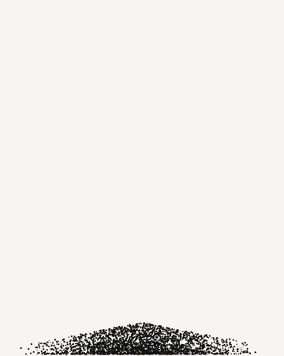

# sand-portrait

Any image, as sand. Dots rise from a pile of sand into a portrait, then scatter away from your cursor and spring back. Click to send a ripple.



- **No dependencies**, one file, under 6 KB gzipped
- Works with a `<script>` tag or as an ES module
- Light and dark modes, any colours
- Honours `prefers-reduced-motion`, pauses off screen, redraws on resize
- Photos, logos and wordmarks (`SandPortrait.text`)

**[Live demo](https://www.hellosaiful.com/lab/sand-portrait/)**: drop in your own photo or type a word. The same effect runs on [hellosaiful.com](https://www.hellosaiful.com).

## Use it

```html
<canvas id="me" style="width: 400px; height: 500px"></canvas>
<script src="https://cdn.jsdelivr.net/gh/hellosaifuli/sand-portrait@v1.0.0/sand-portrait.js"></script>
<script>
  SandPortrait(document.getElementById('me'), { src: 'me.png' });
</script>
```

Or as a module:

```js
import SandPortrait from 'https://cdn.jsdelivr.net/gh/hellosaifuli/sand-portrait@v1.0.0/sand-portrait.mjs';

const sand = SandPortrait(canvas, { src: 'me.png', on: 'dark', color: '#fff' });
```

Size the canvas with CSS. The effect fills it and redraws when it changes size.

**Best results:** a cut-out photo with a transparent background (PNG or WebP). Plain studio or wall backgrounds are detected from the corners and left empty. The image must be same-origin or served with CORS headers.

## Options

| Option | Default | What it does |
| --- | --- | --- |
| `src` | | Image URL |
| `source` | | A ready ``, `<canvas>` or `ImageBitmap` instead of `src` |
| `on` | `'light'` | `'light'`: dark dots on a light page. `'dark'`: light dots on a dark page |
| `color` | canvas CSS `color` | Dot colour |
| `accent` | `'#F26A1B'` | Colour of dots that are moving, under the lens or in a ripple |
| `gap` | `6` | Pixels between dot centres. Bigger means fewer, chunkier dots |
| `flat` | `0` | Above 0, every dot gets the same size (a share of `gap`). Use it for text and logos |
| `fit` | `'cover'` | `'cover'` fills the canvas; `'contain'` shows the whole image |
| `posX`, `posY` | `0.5` | Where the image sits when cropped, like CSS `object-position` |
| `skipBackground` | `true` | Leave a plain photo background empty |
| `intro` | `true` | Rise from a sand pile on first draw |
| `introOnView` | `false` | Hold the intro until the canvas scrolls into view |
| `hold` | `450` | Milliseconds before the intro starts |
| `duration` | `1500` | Milliseconds for each dot's rise |
| `interactive` | `true` | Dots scatter from the pointer and spring back |
| `radius` | `70` | Reach of the pointer's push, in pixels |
| `lens` | `90` | Radius of the hover lens that swells dots (`0` turns it off) |
| `ripples` | `true` | Click or tap sends a ripple |
| `loop` | `false` | A gentle ripple every few seconds while the cursor is idle |
| `reducedMotion` | `'auto'` | `'auto'` turns off the intro and interaction for people who ask for less motion |
| `autoResize` | `true` | Redraw when the canvas changes size |
| `onReady`, `onDone`, `onError` | | Called after each draw, once the intro ends, and if the image fails |

## Methods

```js
const sand = SandPortrait(canvas, options);

sand.replay();                          // play the sand-pile intro again
sand.setImage('other.png');             // swap the image (URL, , <canvas>)
sand.set({ on: 'dark', color: '#fff' }); // change options live
sand.destroy();                         // stop and remove every listener
```

## A wordmark in sand

```js
await document.fonts.load('800 200px "Bricolage Grotesque"');
SandPortrait(canvas, {
  source: SandPortrait.text('saiful.', { font: '800 200px "Bricolage Grotesque"' }),
  fit: 'contain', flat: 0.42, color: '#D4F25A',
});
```

## Accessibility

The canvas is decoration. Mark it `aria-hidden="true"` and keep the real image or text on the page for screen readers, for example as an `` that the canvas sits over. With `reducedMotion: 'auto'` (the default), people who ask for less motion see the finished image with no intro or interaction.

## Licence

MIT © [Saiful Islam](https://www.hellosaiful.com). Product designer who ships code.
